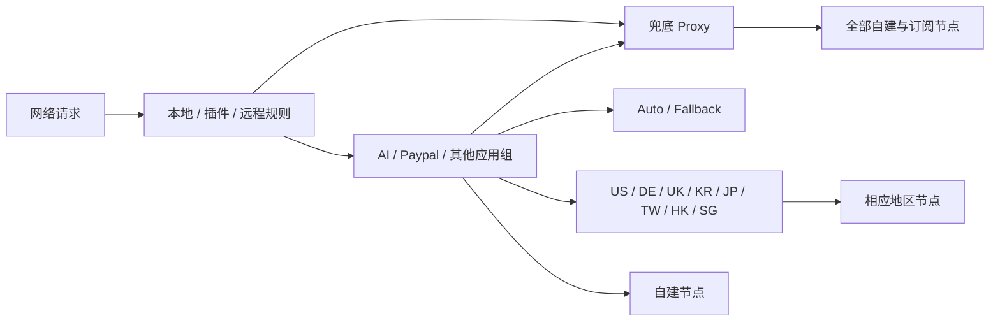

# 我的 Loon 分流工程

把分流当作一个可维护的项目：规则有出处，修改能比较，重要行为有检查，出问题能回退。

当前版本是 **v0.1 本地基础版**。它从已经确认的配置迁移而来，保留现有行为。公开范围已定为公开，GitHub 仓库地址尚未配置，CI 文件已准备但尚未在 GitHub 运行。现用配置不会被工具自动覆盖。

## 现在的分流结构



- `Proxy` 展开全部节点，不嵌套自动选择和地区组。
- 应用组显示 `Proxy / Auto / Fallback / 自建节点 / 八个地区组`；原有 DIRECT 选项保留。
- PayPal 通过 `Paypal → US / DE / UK` 手动选择。它不根据登录账户自动区分国家。
- 最终兜底是 `FINAL,Proxy`。

## 改什么文件

| 想修改什么 | 文件 |
| --- | --- |
| 每个 App / 网站的现状、新增流程、设备验证记录 | [`docs/services.md`](docs/services.md) |
| 自己的站点与地区例外 | `rules/local/personal.list` |
| Wi-Fi Calling 等运营商规则 | `rules/local/carriers.list` |
| 明确的 AI 例外 | `rules/local/ai-overrides.list` |
| 局域网、国内直连、基础网络 | `rules/local/network.list` |
| 最终兜底 | `rules/local/final.list` |
| 应用菜单、地区筛选、DNS 等公开配置 | `config/profile.template.lcf` |
| 第三方规则与插件的 URL、策略、启用状态和顺序 | `config/upstreams.json` |
| 规则片段的加载顺序、已知遗留问题 | `config/project.json` |
| 不能改坏的分流预期（每条本地域名规则都必须登记） | `tests/expectations.json` |
| 自建节点、订阅地址和证书 | `.local/private.json`，仅本地 |

`rules/local/` 是构建片段，包含明确出口策略；当前在构建时写入本地 Rule 段。**不要直接把这些片段当成远程订阅添加**，否则可能改变来源优先级。第三方规则目前继续引用原作者地址，没有整库复制或宣称由本项目维护。

## 本地使用

需要 Python 3.9+ 和 Git，无第三方 Python 依赖。

```bash
python3 tools/project.py check
python3 -m unittest discover -s tests -v
python3 tools/project.py build
```

输出 `dist/loon.lcf`，权限为 0600；通过本地方式传到 Loon 后再导入。它包含私人数据，不作为 GitHub Actions 产物上传。

本机已把现有私密设置迁移到 `.local/private.json`，不需要再次填写。新电脑可从 `config/private.example.json` 复制为 `.local/private.json`，然后在本地补全；不要把私密信息填回示例文件。

```bash
# 仅迁移时使用：确认生成结果与冻结的旧版有效配置一致
python3 tools/project.py verify-baseline
```

`.local/baseline.lcf` 也是本地文件。开始有意修改规则后，不要求继续与旧版完全一致；此时用规则预期、Git diff 和 Loon 请求日志验证。

## 一次规则变更怎么做

1. 记录实际域名、想走的策略、目前命中的规则；不要提交完整账户请求或令牌。
2. 修改对应片段或上游来源记录，补充规则预期。
3. 运行检查和测试，查看 Git diff。
4. 生成配置，在设备上用 Loon 请求日志验证。
5. 确认后提交修改。需要回退时从已验证的 Git 提交恢复公开文件，再在本地重新构建。

已有三个运营商 IP 规则缺少明确策略，属于用户选择保留的旧配置：检查会发出三条警告；新增缺策略规则会报错。WeatherKit 原 URL 在 2026-09-26 核对时返回 404，按此前选择仍启用。[已知问题与后续计划](docs/roadmap.md)

## GitHub 的职责

GitHub 只保存公开配置模板、规则来源、维护说明和检查程序。节点、订阅凭据、证书、冻结的完整配置及构建产物都在忽略目录中。CI 不需要这些私人内容，也不自动发布完整配置。

第一版 CI 检查结构、组引用、循环、相同本地条件的策略冲突、已登记的分流预期及常见凭据误提交。它不下载第三方规则、不运行插件脚本，也不是 Loon 原生解析器。远程内容变化导致的覆盖冲突，需要后续加入快照审查和设备验证。

准备发布时只使用本目录 `loon-rules/`，不要把上一级历史工作目录整体上传。[设计边界](docs/design.md)

## 文档依据

- [Loon 规则及优先级](https://nsloon.app/docs/Rule/)
- [Loon 策略组](https://nsloon.app/docs/Policy/policygroup/)
- [Loon 订阅规则](https://nsloon.app/docs/Rule/sub_rule/)
- [GitHub 固定版本链接](https://docs.github.com/en/repositories/working-with-files/using-files/getting-permanent-links-to-files)

没有为引用的第三方规则、插件或图标重新授权；其版权和许可归各自作者。首次对外发布前再确定本项目自有部分采用的许可证。
